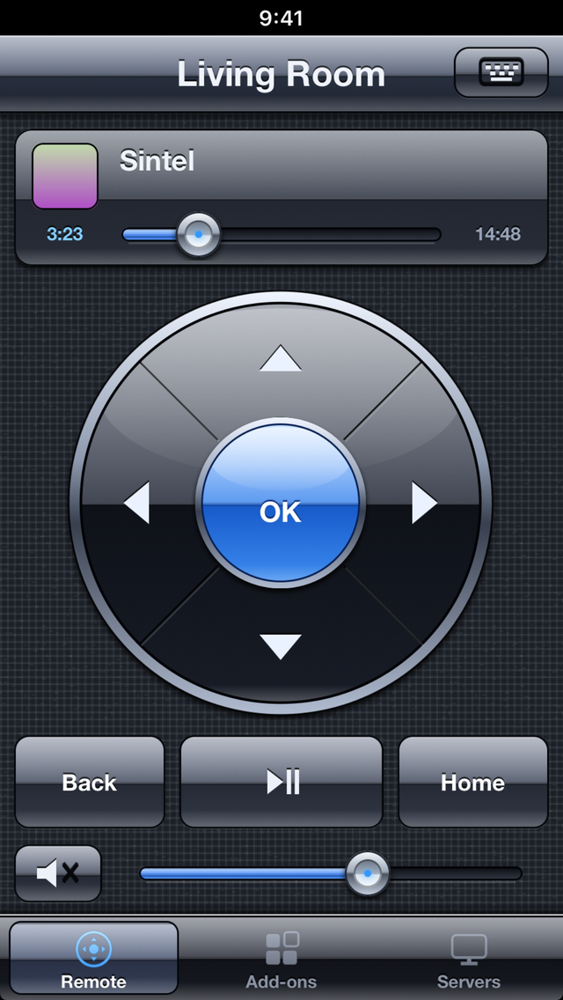
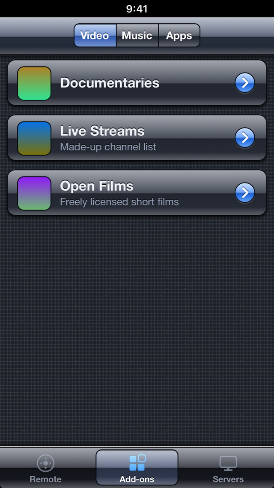

# KodiRemote

A remote control for [Kodi](https://kodi.tv) written for old iPhones running **iOS 6**: a direction pad, play/pause, a seek
bar and volume slider, add-on shortcuts, and a way to type into Kodi's on-screen text boxes from the phone's keyboard.
It talks to Kodi over its documented JSON-RPC interface, so nothing has to be installed on the Kodi side.

 

*Screenshots are from the simulator against `tools/mock_kodi.py` with made-up data.*

This is an unofficial project. It is **not affiliated with or endorsed by the Kodi Foundation / XBMC**. "KodiRemote" is a
descriptive working name; if you publish a build or a fork, check Kodi's trademark policy and rename it if needed.

## Status

Written for and used on one iPhone 5 (iOS 6.1.3, jailbroken) against one Kodi installation. The networking core is covered by
automated tests against a mock server (see [Tests](#tests)); the UI has been looked at in the iOS simulator, not tested
systematically on other devices, iOS versions or Kodi versions. See [Limitations](#limitations).

## Features

- **Remote tab**: now-playing strip (cover art, title, artist / show and episode / album, elapsed and total time, a seek
  slider), a round direction pad (up, down, left, right, OK; arrows repeat while held), Back, Play/Pause and Home keys, mute
  and a volume slider that follows Kodi's volume. Pad and keys give a short vibration tick on touch-down.
- **Text input**: when Kodi opens a text box (search, password, rename, number or IP address entry) it announces that over its
  TCP notification channel and the app pops up a prompt on the phone; what you type is sent with `Input.SendText`. There is also a
  keyboard button in the title bar for sending text to a text box that is already open. The prompt for passwords is masked.
- **Add-ons tab**: lists the enabled video, music and program add-ons with their icons. Tapping a video or music add-on opens it
  in Kodi's matching window; tapping a program add-on runs it.
- **Servers tab**: saved servers, servers found on the network, and "Add by address". Discovery uses Bonjour
  (`_xbmc-jsonrpc-h._tcp.` and `_xbmc-web._tcp.`) and an optional sweep of the Wi-Fi subnet for ports 8080 and 80. A new address is
  checked first, and a missing web server, a wrong port or a wrong password are explained instead of silently saved.
- **Passwords**: a server that answers 401 makes the app ask for the user name and password from Kodi's web server settings.
- Drawn entirely in code in an iOS 6 style (glossy bars, linen backdrop); no image assets except the icon and launch images.

## Requirements

On the Kodi machine, **Settings > Services > Control**:

- *Allow remote control via HTTP* on (the web server; port 8080 by default),
- *Allow remote control by applications on other systems* on, if you want the text-box prompt (it uses TCP port 9090, which is
  fixed in the app),
- *Announce services to other systems* on, if you want Bonjour discovery.

On the phone: iOS 6.0 or later, armv7 (developed on an iPhone 5), and a way to run an unsigned app: a jailbreak with
[AppSync Unified](https://cydia.akemi.ai/) installed. The simulator needs no jailbreak.

On the Mac: Xcode (command line tools and the iOS Simulator SDK) and `python3`. `make_assets.py` also needs Pillow. For a device
build you need the iOS 9.3 SDK stubs, which `tools/setup-sdk.sh` fetches (Xcode no longer ships an armv7 iOS SDK).

## Build

    tools/setup-sdk.sh                         # once: downloads and patches the public iOS 9.3 SDK into ./.sdk
    export SDK93="$PWD/.sdk/iPhoneOS9.3.sdk"
    ./build.sh device                          # build/KodiRemote.ipa, armv7, iOS 6.0, unsigned
    ./build.sh sim                             # build/sim/KodiRemote.app, arm64 iOS Simulator

The device build compiles the Objective-C with ARC but links without it: current Xcode has no `libarclite` for iOS 6, and the
iOS 6 runtime already provides the ARC entry points the code uses. The SDK is only used for headers and link stubs
(`-undefined dynamic_lookup`); the real frameworks on the phone are used at run time.

## Install

Install the unsigned IPA on a jailbroken phone that has AppSync Unified:

    ideviceinstaller install build/KodiRemote.ipa      # libimobiledevice; or copy the IPA over and use any IPA installer

For the simulator:

    xcrun simctl install booted build/sim/KodiRemote.app
    xcrun simctl launch booted com.savrum.kodiremote

(The bundle identifier is `com.savrum.kodiremote`; change it in `Info.plist` if you fork.)

## Trying it without Kodi

`tools/mock_kodi.py` is a stand-in for Kodi using only the Python standard library:

    python3 tools/mock_kodi.py --port 8090                 # JSON-RPC on 8090, notifications on 9090, a movie "playing"
    python3 tools/mock_kodi.py --user kodi --password secret   # with HTTP Basic authentication

It answers the JSON-RPC methods the app uses, serves generated pictures for `/image/...`, advances the playback position, and
logs the calls it gets (`GET /mock/log`). `POST /mock/notify` pushes a notification to connected clients, for example a text box
request; `--split` sends each notification in two TCP segments. Run `python3 tools/mock_kodi.py --help` and see the file header.

### Simulator preview hooks

The simulator build (`./build.sh sim`, which defines `KR_PREVIEW`) reads a few environment variables, so a screen can be reached
without tapping. Pass them to the app with the `SIMCTL_CHILD_` prefix:

| Variable | Effect |
| --- | --- |
| `KR_HOST=host:port` | Saves that server and connects to it, e.g. `127.0.0.1:8090` for the mock. |
| `KR_NAME=...` | Name shown for the `KR_HOST` server (default "Living Room"). |
| `KR_TAB=0\|1\|2` | Opens the Remote, Add-ons or Servers tab. |
| `KR_PROMPT=1` | Shows the "Add server" prompt one second after launch. |

The preview build also draws a fake "9:41" status strip. Example:

    SIMCTL_CHILD_KR_HOST=127.0.0.1:8090 SIMCTL_CHILD_KR_TAB=1 xcrun simctl launch booted com.savrum.kodiremote

Note that opening the Servers tab starts Bonjour discovery, and the Scan button sweeps your real local subnet, in the simulator too.

## Tests

    tests/run.sh

builds `KRClient` and `KRNotifier` (the networking core) as a macOS command-line tool, with a small UIKit shim so they compile
without UIKit, starts `tools/mock_kodi.py` (open, with a password, and a plain HTTP server that is not Kodi), and runs 50 checks:
status mapping (including iOS 6's `-1012` for a 401), the clock text, saved-server bookkeeping, the address probe's four outcomes,
connecting, polling, key and volume calls, JSON-RPC errors, image loading and caching, the password flow, and text-box
notifications arriving over TCP in split segments. The notification test needs port 9090 free on the Mac and is reported as
skipped otherwise. There are no automated tests of the UI.

## Project layout

| Path | Purpose |
| --- | --- |
| `src/main.m` | App delegate: tabs, restores the last server, password prompt on 401, text-box prompt on Kodi's request, simulator hooks. |
| `src/KRClient.*` | The connection to one Kodi: JSON-RPC over HTTP, 2-second poll of volume and player state, Basic auth, address probe, image cache, saved servers in `NSUserDefaults`. |
| `src/KRNotifier.*` | Reads Kodi's TCP notification stream (port 9090), cuts the concatenated JSON objects apart, reconnects after errors and after the app wakes up. |
| `src/KRDiscovery.*` | Bonjour browsing and the /24 subnet sweep. |
| `src/KRRemoteController.*` | Remote tab layout and key handling. |
| `src/KRAddonsController.*` | Add-ons tab. |
| `src/KRServersController.*` | Servers tab: saved and found servers, add by address with probing. |
| `src/KRControls.*` | Direction pad, buttons, sliders, now-playing view, and the vibration tick. |
| `src/KRChrome.*` | Custom navigation bar, segmented control, tab bar and the small screen stack (UIKit's bars are not used). |
| `src/KRCards.*`, `src/KRPrompt.*`, `src/KRStyle.*` | List cards, an in-app replacement for `UIAlertView`, and the drawing helpers. |
| `tools/mock_kodi.py`, `tools/setup-sdk.sh` | Mock Kodi; iOS 9.3 SDK fetch and patch. |
| `tests/` | `run.sh`, `kr_tests.m`, and the UIKit shim. |
| `make_assets.py`, `res/` | Generates the icon and launch images (`python3 make_assets.py`, needs Pillow). |

## How it works

`KRClient` is a singleton that holds the selected server (name, host, port, optional user and password). Every call is a
JSON-RPC POST to `http://host:port/jsonrpc` with a 4-second timeout, with a `Basic` `Authorization` header when a user is set.
A timer fires every two seconds; while no poll is outstanding it asks for `Application.GetProperties` (volume, muted),
`Player.GetActivePlayers`, and, if something plays, `Player.GetItem` and `Player.GetProperties` for the first active player. Each
`connectTo:` bumps a generation counter so late answers of a previous server are dropped. The UI observes `KRClientChanged`.

Keys are single calls: the direction pad and Back/Home use `Input.Up`, `Input.Down`, `Input.Left`, `Input.Right`, `Input.Select`,
`Input.Back`, `Input.Home`; Play/Pause and Mute use `Input.ExecuteAction` (`playpause`, `mute`); the slider uses
`Application.SetVolume` (at most about eight times a second while dragging) and `Player.Seek` with a percentage.

`KRNotifier` opens a plain TCP connection to the same host on port 9090. Kodi pushes `Input.OnInputRequested` and
`Input.OnInputFinished` there with no framing between objects, so the notifier scans for balanced braces (aware of strings and
escapes) and hands each object on. `main.m` turns a request into a prompt (masked for passwords) and sends the result with
`Input.SendText`; cancelling sends `Input.Back`.

Because iOS 6's `NSURLConnection` answers a `401` that nobody handles with the error `-1012` ("user cancelled authentication")
and no response object, `KRHTTPStatus()` maps that error to 401. Without it a password-protected Kodi would look unreachable.
(macOS behaves the same way, which is why the tests exercise the same path.)

## Network and privacy

The app talks only to the Kodi servers you add: HTTP on the web server port and TCP on 9090. There is no analytics and no
other network traffic. Discovery sends Bonjour queries and, only when you tap Scan, HTTP requests to every address of your /24 on
ports 8080 and 80.

Kodi's web server uses **plain HTTP with Basic authentication**, so the password travels unencrypted on your local network. The
app stores each server, including the **user name and password in plain text**, in its `NSUserDefaults` (the app's preferences
file on the device); it does not use the Keychain. Use a password you do not use elsewhere, and do not use the app on networks you
do not trust. Logging is limited to the JSON-RPC method name, HTTP status and error code of calls that are not part of the poll.

## Limitations

- Only HTTP: a Kodi web server behind HTTPS is not supported. IPv4 only; the address field takes `host` or `host:port`.
- The notification port is fixed at 9090. The Scan button only looks at the /24 of the Wi-Fi interface (`en0`), on ports 8080 and 80.
- Kodi cannot be brought to the foreground, woken, or powered on or off through JSON-RPC, so there are no power keys and opening an
  add-on does not switch the TV to Kodi if another app is in front.
- Only the first active player is shown and controlled. There are no previous/next/stop or library-browsing controls (the glyphs
  exist in `KRControls` but no keys use them); transport is Play/Pause plus the seek bar, volume is the slider.
- Text input only works while Kodi has a text box open; Kodi's own date and time pickers are not forwarded.
- iPhone layout, portrait only. Tested on an iPhone 5 with iOS 6.1.3 only.
- The vibration tick calls `AudioServicesPlaySystemSoundWithVibration`, a private entry point looked up at run time (with the
  public vibrate call as fallback). This and the unsigned distribution mean the app is not suitable for the App Store.
- From reading the code (not checked on a device): after you cancel the password prompt, the next poll gets a 401 again and the
  prompt returns within a couple of seconds.

## Contributing

See [CONTRIBUTING.md](CONTRIBUTING.md). Bug reports should name the device, the iOS version and the Kodi version.

## Licence

[MIT](LICENSE). See [THIRD_PARTY_NOTICES.md](THIRD_PARTY_NOTICES.md); nothing third-party is bundled.
